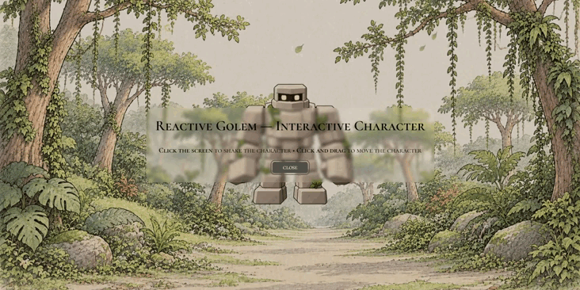

<p align="center">
  
</p>

# Reactive Golem — Interactive Character

Um personagem interativo inspirado no estilo LEGO, ambientado em um cenário ilustrado de floresta. Explore suas animações e interaja com o golem por meio de cliques e movimentos do mouse.

## Prévia



## Características

<p align="center">
  
  
  
  
  
</p>

## Funcionalidades

<div align="center">
  <table>
    <tr>
      <td align="center" width="25%">
        <h3>👀 Piscadas</h3>
        <p>O personagem pisca automaticamente.</p>
      </td>
      <td align="center" width="25%">
        <h3>💥 Tremor</h3>
        <p>Animação acionada por clique.</p>
      </td>
      <td align="center" width="25%">
        <h3>🖱️ Drag and Drop</h3>
        <p>Mova o personagem pela tela.</p>
      </td>
      <td align="center" width="25%">
        <h3>🍃 Folhas cadentes</h3>
        <p>Folhas animadas dão movimento ao cenário.</p>
      </td>
    </tr>
  </table>
</div>

## Tecnologias

<p align="left">
  
  
  
  
</p>

## Como clonar o repositório

```bash
git clone https://github.com/fabicrz/Reactive-Golem.git
```

## Conclusão

O Reactive Golem é uma experiência web interativa que combina animações, manipulação de SVG e interações com o usuário. O projeto explora recursos de front-end para dar vida a um personagem em um cenário ilustrado, reunindo elementos visuais e funcionalidades em uma aplicação simples.